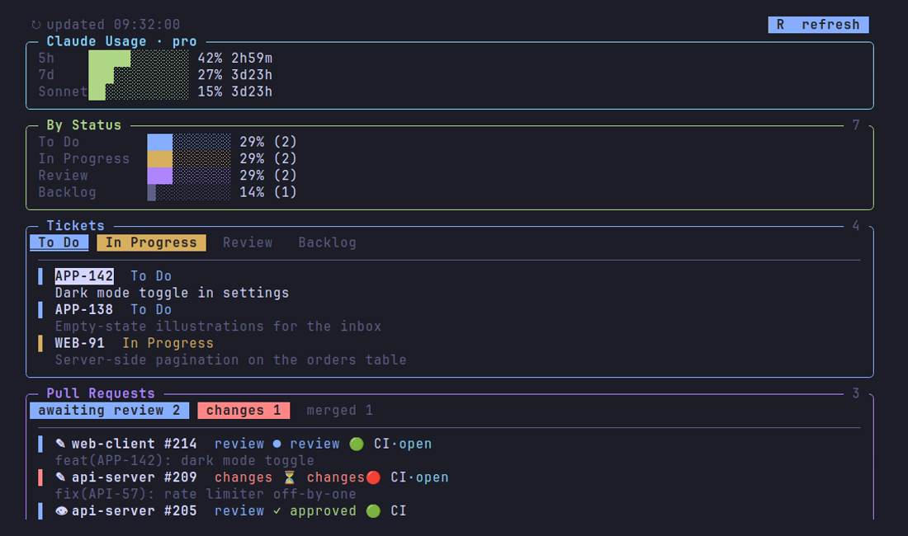

# codepit

Your dev day on one terminal panel — a glass cockpit for code. Built on
[Zellij](https://zellij.dev) with Python **standard library only**, `codepit` shows,
without leaving the terminal: a block-font clock, your assigned tickets, the pull
requests waiting on you, and your Claude Code usage — in one refreshable pane. Every
panel and data source is chosen at setup.

Built as a personal study project. The interesting parts: **zero pip dependencies**, a
`curses` interactive pane, a hand-written **MCP-over-HTTP client** (no SDK), pluggable
backends behind a tiny dispatcher, and a plain `unittest` suite.




## Panels (toggle any of them at setup)

- **clock** — big block-font clock, date, and the Brazilian national holiday of the day.
- **claude** — your 5h / 7d / per-model Claude usage bars, read from the local Claude Code credentials.
- **tickets** — your open tickets, filterable by status with clickable chips and scroll.
- **prs** — open PRs where you're author *or* reviewer, with review/CI status badges.
- **heatmap** — a grid of your last 12 weeks of GitHub contributions (commits, PRs, issues, reviews), with weekday and month labels.
- **pet** — an ASCII companion that walks back and forth beside the Clock, blinking periodically, whose mood reflects today's GitHub contributions + Claude usage.

`heatmap` and `pet` always use GitHub (via `gh`) — there's no source to pick for them,
unlike `tickets`/`prs` below.

## Data sources (pick one per panel at setup)

| Panel   | Sources                                   | Status                          |
|---------|-------------------------------------------|---------------------------------|
| tickets | **GitHub Issues**, **Jira**, **MCP**, Trello | GitHub + Jira + MCP work; Trello planned |
| prs     | **GitHub**, GitLab, Bitbucket, MCP        | GitHub works; the rest planned  |

Adding a backend is one file under `lib/tickets/` or `lib/prs/` plus a line in that
package's dispatcher — the contract is small (`fetch(cfg)` returning normalized dicts).

## Requirements

- Linux, Python 3.8+
- [`gh`](https://cli.github.com) authenticated (`gh auth login`) — for the GitHub backends
- [Zellij](https://zellij.dev) — installed for you by `install.sh`, no root needed

## Install

One command does everything: installs Zellij, walks you through picking panels and data
sources, writes your config, and drops you straight into the dashboard.

```bash
./install.sh
```

Answer "all" (or just hit enter) at the panels prompt to turn everything on. Re-run
`./install.sh` any time to reconfigure — it skips steps already done (Zellij binary,
`.env`) and re-asks the rest. After the first run, new terminals can just run `cpit`.

### Try it with demo data

No accounts, no config — see the dashboard with invented tickets/PRs/usage:

```bash
CODEPIT_CONFIG=config.demo.json python3 widgets/board.py   # just the board pane
CODEPIT_CONFIG=config.demo.json cpit                       # the full layout
```

## Configuration

`install.sh` runs this for you on first install. `setup.py` is also re-runnable on its
own — run `python3 setup.py` any time you just want to change panels/sources without
touching the Zellij binary or PATH setup. It writes:

- **`config.json`** (gitignored, per-user) — which panels, which source per panel, and
  non-secret options (PR role, repo filters).
- **`.env`** (gitignored, chmod 600) — secrets, e.g. the MCP key. GitHub backends need no
  secret; they use the `gh` CLI's own auth.
- the Zellij layout, regenerated to match the panels you kept.

To edit by hand instead, copy `.env.example` to `.env` and write `config.json` yourself
(see the defaults in `lib/config.py`).

## Shortcuts

**Zellij:** switch pane `Ctrl+p` + arrows · new shell tab `Alt+t` · close tab `Alt+w` ·
click a stacked pane's title to toggle it · detach `Ctrl+o d` · quit `Ctrl+q`.
(The `Alt+t`/`Alt+w` binds come from `config.kdl`; if you already have a
`~/.config/zellij/config.kdl`, add its `keybinds { shared { ... } }` block manually.)

**Pane (when focused):** `←/→` move chip · `space` toggle status filter · `a` all · `n` none ·
`↑/↓` (or `j/k`) move the ticket cursor · `Enter` open the selected ticket in the browser ·
`1`/`2`/`3` toggle PR category · `R` refresh · `q` quit. You can also click the chips and the `R` button.

## Tests

```bash
python3 -m unittest discover -s tests -t . -v
```

No dependencies to install — everything is Python standard library.

## License

[MIT](LICENSE)
